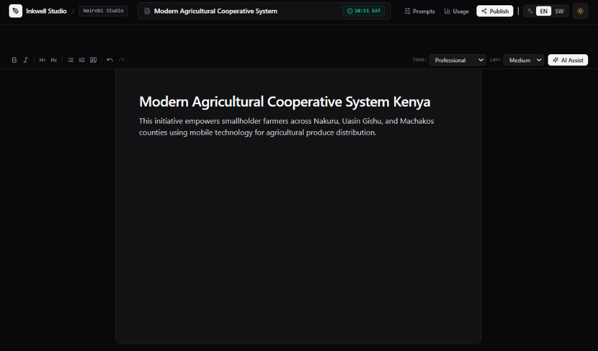
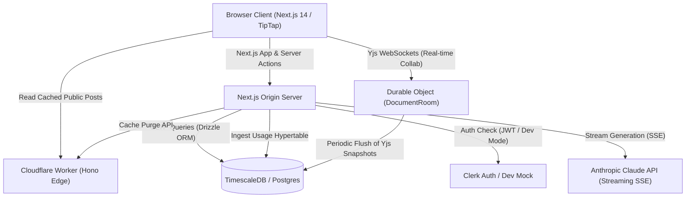

# Inkwell Studio

> **Production-grade AI content studio with TipTap collaborative editing, prompt version control, TimescaleDB dual-currency usage tracking (KES/USD), edge caching, and regional East African safeguards.**



[](https://nextjs.org/)
[](https://www.typescriptlang.org/)
[](https://tailwindcss.com/)
[](https://turbo.build/repo)
[](https://vitest.dev/)
[-10B981>)](https://en.wikipedia.org/wiki/East_Africa_Time)
[](#regional-east-african-context)
[](LICENSE)

---

## Overview

Independent journalists, technical writers, and nonprofit founders across East Africa face distinct friction when producing high-stakes content:

1. **Contextual Inaccuracy**: Global AI templates default to Western idioms, missing East African market realities, bilingual English-Swahili phrasing, and regional development frameworks (e.g., USAID East Africa, regional cooperative models).
2. **Fragile Prompting**: Creators iterate on system instructions without version control, leading to silent quality regressions.
3. **Collaboration Hurdles**: Teams require real-time Google Docs-style live co-authoring without compromising editor latency or leaking API keys.
4. **Opaque Usage & Costs**: Creators need transparent accounting in Kenyan Shillings (`KES`) alongside USD, backed by budget protection guards.

**Inkwell Studio** solves this with an integrated creative workspace: semantic prompt versioning, real-time TipTap + Yjs co-authoring, token-by-token streaming insertion, static publishing with sub-second edge cache purge, and TimescaleDB-driven cost accounting.

---

## Architectural Overview



---

## Core Features

- **Minimalist Linear-Inspired Dark Mode**: Deep zinc foundation (`zinc-950`) with elevated cards, 1px subtle borders, zero-flicker client-side persistence (`localStorage.theme`), and system preference support.
- **Global Bilingual Synchronization**: Native East African Swahili (`sw-KE`) and English (`en-KE`) switcher (`LanguageProvider`) persisted to `localStorage`, synchronizing navigation, prompts, and TipTap canvas text across all routes.
- **Redesigned Editorial Title Bar**: Focused title input pill with real-time autosave indicators (`Saving...`, `Saved • 10:51 EAT`, `Unsaved`), workspace tags, and one-click static publication.
- **TipTap Streaming Editor**: Token-by-token streaming directly into the ProseMirror editor with tone, length, and language toggles, plus floating diff accept/reject blocks.
- **Real-Time Co-Authoring (CRDTs)**: Multi-user collaborative editing via Yjs (`y-prosemirror`) backed by Cloudflare Workers Durable Objects (`DocumentRoom`) with live user awareness cursors.
- **Prompt Version Control Studio**: Semantic versioning (SemVer) for system prompts, visual line diffs, non-destructive rollbacks, and concurrent A/B stream comparison.
- **Sub-Second Static Publishing**: One-click static publication generating dynamic Open Graph tags, JSON-LD structured data, and sub-second Cloudflare edge cache purge (`<1000ms SLA`).
- **TimescaleDB Usage & Cost Analytics**: Continuous aggregates calculating input/output token volume with dual-currency reporting (`KES` and `USD`) and automated email budget threshold alerts (80% and 100% hard stops).
- **Security & PII Hygiene**: Guardrails defending against indirect prompt injection, untrusted delimiter wrapping, bilingual moderation, and automatic redaction of Kenyan phone numbers (`+254...`) and M-Pesa receipts.

---

## Architecture Decision Records (ADRs)

Key architectural trade-offs are documented under [`docs/adr/`](docs/adr/):

- **[ADR 0001: Partitioning Edge Worker vs Origin Server Responsibilities](docs/adr/0001-edge-worker-vs-origin-responsibilities.md)**: Cloudflare Worker handles ingress, JWT auth, token bucket rate limits, edge cache, and WebSocket co-authoring; Next.js origin holds Anthropic secrets and executes Drizzle/Timescale queries.
- **[ADR 0002: TimescaleDB for Usage Analytics & Drizzle ORM for Relational OLTP](docs/adr/0002-timescale-for-usage-and-drizzle-for-oltp.md)**: Hypertables and continuous aggregates for sub-millisecond dual-currency budget telemetry.
- **[ADR 0003: Yjs CRDTs and Cloudflare Durable Objects for Real-Time Collaboration](docs/adr/0003-yjs-durable-objects-for-realtime-collaboration.md)**: Deterministic edge rooms (`DocumentRoom`) with binary update relay and transactional persistence.

---

## Monorepo Structure

```text
inkwell-studio/
├── apps/
│   └── web/                   # Next.js 14 App Router, TipTap Editor, Tailwind CSS
│       ├── src/
│       │   ├── app/           # App Router pages (/editor, /prompts, /usage, /p/[slug])
│       │   ├── components/    # Reusable UI, TipTap toolbar, diff viewers, charts
│       │   ├── context/       # LanguageContext (global bilingual persistence)
│       │   └── lib/           # Anthropic client, budget guards, diff engine, safeguards
│       ├── postcss.config.js  # Tailwind CSS & Autoprefixer configuration
│       └── tailwind.config.ts # Design tokens, dark mode class strategy
├── packages/
│   ├── db/                    # Drizzle ORM schemas (PostgreSQL & TimescaleDB hypertables)
│   └── edge/                  # Cloudflare Workers, Hono, Durable Objects (DocumentRoom)
├── tests/                     # 37 Vitest tests covering all 10 project phases
├── docs/                      # Architectural specs, ADRs, and assets
│   ├── adr/                   # Architecture Decision Records
│   └── images/                # Product screenshots and diagrams
├── docker-compose.yml         # Local TimescaleDB (PostgreSQL 16) container definition
└── turbo.json                 # Turborepo task pipeline configuration
```

---

## Regional East African Context

- **Currency**: Primary currency is Kenyan Shillings (`KES`), backed by secondary USD conversion (`130 KES = 1 USD`).
- **Timezone**: Default timezone is `Africa/Nairobi` (UTC+3 / EAT) across usage events, publication timestamps, and rollup windows.
- **Localization**: Full Swahili (`sw-KE`) and English (`en-KE`) bilingual experience with zero-flicker client-side persistence.
- **Kenyan PII Redaction**: Regex-driven automatic scrubbing for Safaricom/Airtel phone numbers (`+254 7XX...` / `+254 1XX...`) and M-Pesa transaction receipts.
- **Zero-Credential Developer Mode**: All third-party services include deterministic offline fallbacks (`AUTH_MODE=dev`, `AI_MOCK_MODE=true`, `EMAIL_ADAPTER=mock`), enabling complete local testing without external API keys.

---

## Tech Stack

| Layer                    | Technology                                                            |
| ------------------------ | --------------------------------------------------------------------- |
| **Monorepo Engine**      | npm Workspaces, Turborepo                                             |
| **Frontend Framework**   | Next.js 14 (App Router), React 18, TypeScript (`strict`)              |
| **Styling & Design**     | Tailwind CSS 3.4 (`darkMode: 'class'`), Lucide Icons                  |
| **Rich Text Editor**     | TipTap React, ProseMirror, Yjs (`y-prosemirror`)                      |
| **Edge Compute**         | Cloudflare Workers, Hono, Durable Objects (`DocumentRoom`), Miniflare |
| **AI LLM Gateway**       | `@anthropic-ai/sdk` (Claude 3.5 Sonnet / dynamic model fallback)      |
| **Database & Analytics** | PostgreSQL 16, TimescaleDB (Hypertables & Rollups), Drizzle ORM       |
| **Authentication**       | Clerk Auth with zero-credential `AUTH_MODE=dev` fallback              |
| **Test Harness**         | Vitest 1.6, Miniflare, 37 passing unit & integration tests            |

---

## Quick Start

### 1. Prerequisites

- **Node.js** >= 18.17.0
- **Docker & Docker Compose** (for local TimescaleDB)

### 2. Clone and Setup

```bash
git clone https://github.com/chris-nairobi/inkwell-studio.git
cd inkwell-studio
cp .env.example .env
npm install
```

### 3. Start Database & Run Migrations

```bash
# Start local TimescaleDB container
npm run docker:up

# Run synthetic seed migration (Chris Odhiambo & Nairobi Innovators Studio)
npm run seed --workspace=@inkwell/db
```

### 4. Run Development Servers

```bash
# Start Next.js web application and Cloudflare edge workers
npm run dev
```

- **Web Studio**: [http://localhost:3000](http://localhost:3000)
- **Edge Worker (Miniflare)**: [http://localhost:8787](http://localhost:8787)

## Public landing page

The project landing page is published at [crnjihia.github.io/inkwell-studio](https://crnjihia.github.io/inkwell-studio/) by the GitHub Pages workflow. It describes the Inkwell Studio project in this repository. GitHub Pages serves static files only; the interactive Next.js application and its API routes require a server-capable deployment.

---

## Verification & Testing

Execute the comprehensive test suite across all 10 architectural phases:

```bash
npm test
```

Expected output:

```text
 ✓ tests/editor-actions.test.ts (3 tests)
 ✓ tests/safeguards.test.ts (6 tests)
 ✓ tests/budget-alerts.test.ts (3 tests)
 ✓ tests/collaboration-convergence.test.ts (3 tests)
 ✓ tests/cache-purge.test.ts (4 tests)
 ✓ tests/prompt-rollback.test.ts (3 tests)
 ✓ tests/edge-rate-limit.test.ts (4 tests)
 ✓ tests/integration/end-to-end-flow.test.ts (6 tests)
 ✓ tests/sse-parser.test.ts (5 tests)

 Test Files  9 passed (9)
      Tests  37 passed (37)
```

## Contributing

Contributions are welcome! Please review [CONTRIBUTING.md](CONTRIBUTING.md) for branch naming conventions, code standards, and PR guidelines.

---

## License

Distributed under the MIT License. See [LICENSE](LICENSE) for more information.
