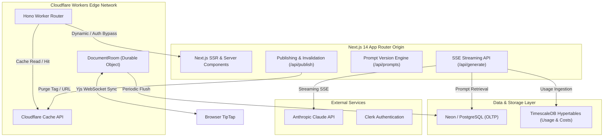

# Inkwell Studio System Architecture

## 1. Overview

Inkwell Studio is engineered as an edge-accelerated, hybrid architecture separating real-time collaborative state, edge routing, AI streaming, and time-series analytical accounting.

## 2. Core Architectural Decisions

### 2.1 Edge Worker vs Origin Server

- **Origin Server (`apps/web`)**: Next.js 14 App Router handles server-side rendering, transactional OLTP database writes via Drizzle ORM, secure Anthropic SDK streaming calls, and prompt versioning. The Anthropic API key is kept strictly within the origin environment.
- **Edge Layer (`apps/edge`)**: Runs on Cloudflare Workers using Hono. It validates Clerk JWTs, enforces per-IP / per-user rate limits before hitting the origin, serves cached static publications with the `Cache API`, and hosts the `DocumentRoom` Durable Object for Yjs real-time collaboration.

### 2.2 Real-Time Collaboration via Durable Objects

Collaborative editing is powered by Yjs using `@tiptap/react` and `y-prosemirror`. Rather than maintaining a centralized persistent WebSocket cluster, clients connect to an edge Durable Object (`DocumentRoom`) keyed by document ID. The Durable Object maintains connected WebSocket awareness, persists incremental document updates in local transactional storage, and flushes consolidated document snapshots to PostgreSQL.

### 2.3 Relational OLTP vs Time-Series Aggregations

- **PostgreSQL**: Used for relational integrity across `users`, `workspaces`, `documents`, `document_versions`, `prompts`, `prompt_versions`, and `publications`.
- **TimescaleDB**: The `usage_events` hypertable records granular token usage metrics (user ID, workspace ID, model ID, input/output tokens, and KES/USD cost). Timescale continuous aggregates compute daily workspace consumption rollups with sub-millisecond query latency for dashboard budgets and threshold alert triggers.

### 2.4 Prompt Version Control & A/B Stream Testing

Prompts are treated as first-class versioned code artifacts. Each prompt has an active version identifier. Edits create an immutable version with a semver-style counter (`1.0.0`, `1.1.0`). Any previous version can be rolled back to instantly. The prompt studio allows creators to run two prompt versions concurrently against the same input to evaluate streaming outputs side-by-side.

### 2.5 Zero-Credentials Local Execution

To support frictionless evaluation and testing, the entire system can run without third-party credentials:

- `AUTH_MODE=dev`: Authenticates as a synthetic Nairobi workspace administrator.
- `AI_MOCK_MODE=true`: Streams simulated, context-aware Kenyan content tokens via SSE.
- `EMAIL_ADAPTER=mock`: Emits budget alert notifications to the local log/memory queue.
